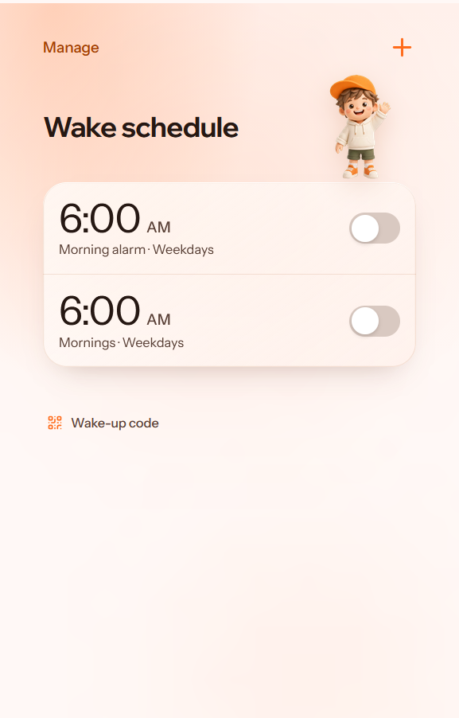

# Ging v3 — QR Wake-Up Alarm

<p align="center">
  
</p>

<p align="center"><strong>A little mascot. A very hard alarm to ignore.</strong></p>

<p align="center">
  
  
  
  
</p>

Ging is a QR-code alarm app. To dismiss a ringing alarm, the user scans their own wake-up code, giving them a reason to get out of bed and move to where the code is placed.

## App preview



## What it does

- Create alarms with a time, label, sound, and repeat days.
- Generate a personal wake-up QR code and save it as an image or printable PDF.
- Scan and validate the code locally with the device camera; only an exact match to the saved code dismisses the alarm.
- Play alarm sounds with the Web Audio API.
- Present a guided setup flow for camera, audio, notifications, and Android device settings.
- Use a warm, mascot-led interface with a branded startup screen, app icons, and browser favicon assets.

### Android alarm behavior

The Android integration is intentionally strict while an alarm is ringing. The native plugin sets the media stream to its maximum level when ringing begins and reapplies it every 2.5 seconds. The activity also handles the back button, requests screen-on/lock-screen window flags, holds a CPU wake lock, and attempts to bring the alarm activity back to the foreground if it is paused. The ringing screen does not provide a snooze or manual dismiss action; successful QR validation is the dismissal path.

These behaviors are implemented across `src/components/AlarmRinger.tsx`, `src/native/GingAndroid.ts`, `android/app/src/main/java/com/ging/alarm/GingAndroidPlugin.java`, and `MainActivity.java`.

## Tech stack

- React 19 and TypeScript
- Vite 6 and Tailwind CSS 4
- Motion for transitions and animation
- Capacitor 8 for the Android app shell and native bridge
- `jsQR` for QR decoding; `qrcode` and `jsPDF` for wake-up code exports
- Web Audio API for alarm sound generation

## Run locally

### Requirements

- Node.js 18 or newer and npm
- For Android builds: Android Studio/SDK and JDK 21

### Web app

```bash
npm install
npm run dev
```

Vite serves the app at `http://localhost:3000`.

To create and preview a production web build:

```bash
npm run build
npm run preview
```

### Android

Build the web assets and sync them into Capacitor before opening Android Studio:

```bash
npm install
npm run build
npx cap sync android
npx cap open android
```

For a local debug APK from PowerShell:

```powershell
cd android
.\gradlew.bat assembleDebug
```

The APK is written to `android/app/build/outputs/apk/debug/`. A release build can be created with `assembleRelease`; configure your own signing credentials locally before distributing it. Signing files and local Android configuration are ignored by Git.

## Project layout

```text
assets/                 Source branding and dashboard preview
android/                Capacitor Android project and native alarm integration
public/                 Web icons, manifest, and mascot artwork
src/App.tsx              App state, persistence, navigation, and alarm scheduling
src/components/          Onboarding, alarm list, QR setup, picker, and ringing screens
src/native/              Typed Capacitor plugin bridge
src/utils/               Audio and QR validation helpers
tests/                   QR validation checks
```

## Data and permissions

Alarm settings and the generated wake-up code are stored in the app's local storage on the device. QR scanning and comparison happen on-device. Camera access is used for scanning; Android overlay and battery settings are requested through the native bridge. No account or hosted backend is required by the app flow.

The onboarding screen tracks six setup items. Some are app checks (such as an audio playback check), while others use an operating-system prompt or Android settings page; they are not all equivalent Android runtime permissions.

## Available commands

| Command | Purpose |
| --- | --- |
| `npm run dev` | Start the local Vite development server |
| `npm run build` | Build the web app into `dist/` |
| `npm run preview` | Preview the production build |
| `npm run lint` | Run the TypeScript compiler without emitting files |
| `npx cap sync android` | Sync web assets and native plugins into Android |

## Platform assets

The repository includes web favicon/PWA assets, Android launcher and splash assets, and an iOS app icon source under `assets/ios/`. The configured native project in this repository is Android; the iOS image set is a branding asset, not a configured iOS build target.
